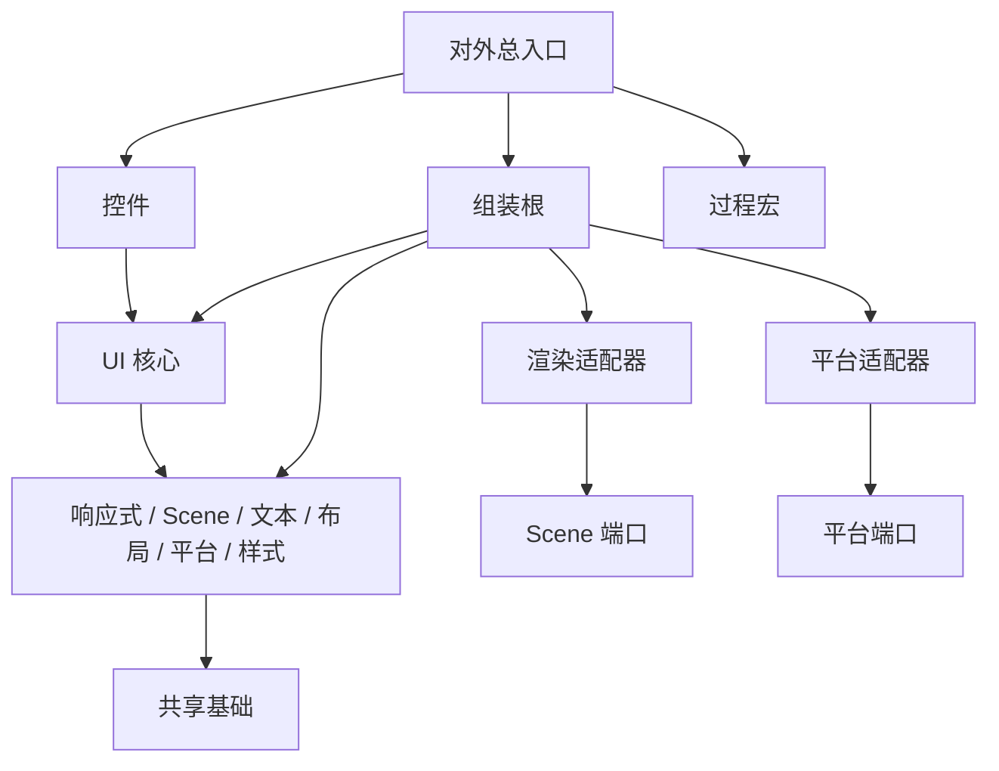

# 上下文映射与依赖边界

oxiview 只面向 macOS、Windows、Linux 原生桌面平台。本文解释 [ADR-0021](adr/0021-crate-layout-strategic-ddd.md) 的限界上下文、公开语言和端口/适配器组织方式，不定义框架功能。

依赖方向的唯一事实来源是 [`xtask/layers.toml`](../xtask/layers.toml)。新增或调整 crate 时在该文件维护上下文（context）、角色（role）及直接依赖允许列表（allow）；本文和检查器不另存一份规则表。规划 crate 尚未创建时自动跳过，现存 workspace 成员未登记则报错。M-1 S3 不创建框架 crate 空壳。

## 上下文与端口

响应式、渲染、文本、布局、平台、样式、UI 核心与控件各自形成限界上下文。共享基础提供跨上下文的数据类型；Scene 是节点树与渲染后端之间的公开语言。平台、渲染等上下文通过自有端口表达所需能力，适配器实现端口，不反向要求端口依赖具体实现。

下图是概念依赖图，箭头表示使用方依赖提供方，省略共享基础边及测试依赖；精确允许列表以规则文件为准。

适配器只使用自己的端口及允许的下层，不互相依赖。组装根负责选择具体实现并连接端口，是唯一可同时依赖端口和适配器的 crate。UI 核心和控件面向端口；对外总入口从组装根、控件和过程宏提供入口。过程宏保持独立。

## 防腐层

第三方实现的类型应通过所在上下文的防腐层转换，避免实现选择传播到其他上下文的公开 API。规则文件中的 external 表限制第三方库的直接使用方，支持精确包名以及末尾 `*` 前缀匹配；新增限制无需修改检查器。类型是否泄漏、样式是否仅使用 Scene 的颜色/几何类型仍需代码审查，依赖图检查不能证明类型级边界。

[ADR-0013](adr/0013-external-content-compositing.md) 明确要求共享 GPU 设备，并允许 wgpu 成为应用公开 API 的一部分。这是对 ADR-0021 通用防腐层原则的特定例外；本步骤只按任务要求登记组装根的依赖权限，不新增 API 或扩大其他上下文的权限。

## 检查语义与验证

`cargo xtask deps` 实现统一 Check 接口，也包含在 `cargo xtask verify` 中。检查器读取 `cargo metadata --format-version 1 --no-deps` 的 workspace 成员及其直接依赖声明；不依赖默认 feature 的解析结果。normal、build、dev、可选依赖和目标平台条件均接受检查，重命名按真实包名匹配。传递的第三方依赖不受上下文直接使用限制，否则上游库的内部实现会被误当成项目跨上下文调用。

普通依赖允许列表对三种依赖类别均生效。标记为 dev-only 的测试工具仅在 dev-dependency 中作为通用例外允许；这不允许其他方向违规通过 dev-dependency 绕过检查。工程工具可豁免出边检查，但禁止其他 crate 依赖它。每条违规输出使用方、被依赖包、依赖类别、目标条件及违反的规则。

同一检查先执行 `cargo deny fetch db` 刷新安全公告数据库，再执行 `cargo deny --offline check`，在刚获取的数据库上检查许可证、安全公告、重复版本及来源。显式获取阶段失败归为环境错误（退出码 2），提示检查网络、代理和缓存权限，不使用旧数据库冒充通过。发现规则违规或依赖审查失败则退出 1；全部通过退出 0。网络恢复后重试即可。

许可证、公告和来源策略在根目录 [`deny.toml`](../deny.toml) 中维护。宽松许可证使用允许列表，未列出的许可证（包括 copyleft）拒绝；多许可证依赖可以选择允许的分支。重复版本只警告，远程来源只允许 crates.io。

报告写入 `target/xtask/report.json`，完整日志写入 `target/xtask/deps.log`。`--json` 保持 stdout 为机器可读 JSON。测试在 `target/xtask/deps-fixture-*` 中生成独立 workspace，结束后清理，不向主 workspace 添加成员，也不要求联网。
