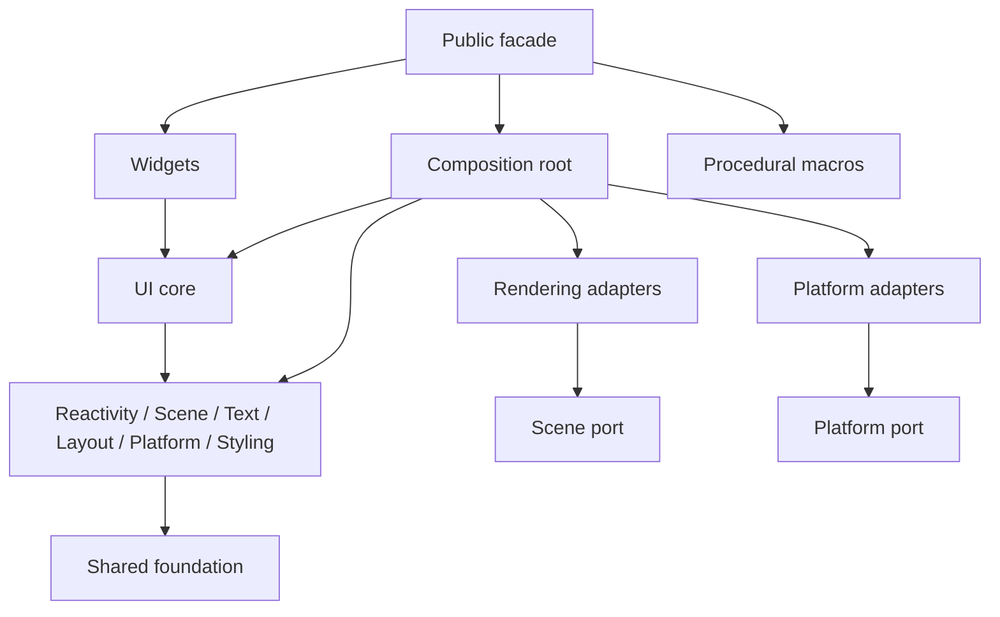

# Context mapping and dependency boundaries

oxiview targets only native macOS, Windows, and Linux desktop platforms. This document explains the bounded contexts, published language, and ports/adapters organization in [ADR-0021](adr/0021-crate-layout-strategic-ddd.md); it does not define framework features.

[`xtask/layers.toml`](../xtask/layers.toml) is the sole source of truth for dependency direction. Maintain each crate's context, role, and direct dependency allowlist there when adding or changing crates; neither this document nor the checker duplicates those rules. Planned crates that do not exist are skipped; unregistered workspace members are errors. M-1 S3 does not create empty framework crates.

## Contexts and ports

Reactivity, rendering, text, layout, platform, styling, UI core, and widgets each form a bounded context. The shared foundation provides cross-context data types; Scene is the published language between the node tree and rendering backends. Contexts such as platform and rendering express required capabilities through their own ports. Adapters implement ports; ports do not depend on concrete implementations.

The following conceptual dependency graph points from consumers to providers. Shared-foundation edges and test dependencies are omitted; the rules file defines the exact allowlists.

Adapters use only their own ports and permitted lower layers, never one another. The composition root selects implementations and wires ports together; it is the only crate allowed to depend on both ports and adapters. UI core and widgets depend on ports. The public facade exposes the composition root, widgets, and procedural macros. Procedural macros remain independent.

## Anti-corruption layers

Convert third-party implementation types through the owning context's anti-corruption layer so implementation choices do not propagate into other contexts' public APIs. The rules file's external tables restrict direct consumers of third-party libraries, supporting exact package names and trailing `*` prefix matching. New restrictions do not require checker changes. Type leakage and whether styling uses only Scene color/geometry types still require code review; dependency graph checks cannot prove type-level boundaries.

[ADR-0013](adr/0013-external-content-compositing.md) explicitly requires a shared GPU device and allows wgpu in the application-facing API. This is a specific exception to ADR-0021's general anti-corruption principle. This step only registers the composition root's dependency permissions as requested; it adds no API and grants no additional permissions to other contexts.

## Check semantics and verification

`cargo xtask deps` implements the common Check interface and is included in `cargo xtask verify`. The checker reads workspace members and direct dependency declarations from `cargo metadata --format-version 1 --no-deps`, independently of default-feature resolution. It checks normal, build, dev, optional, and target-specific dependencies, matching renamed dependencies by their real package names. Transitive third-party dependencies are not subject to direct-consumer restrictions, which would otherwise mistake upstream internals for project cross-context usage.

Ordinary dependency allowlists apply to all three dependency kinds. Test tools marked dev-only are a general exception only in dev-dependencies; this does not allow other direction violations to bypass checks through dev-dependencies. Engineering tools may be exempt from outgoing-edge checks, but other crates may not depend on them. Each violation reports the consumer, dependency package, dependency kind, target condition, and violated rule.

The same check first runs `cargo deny fetch db` to refresh the advisory database, then `cargo deny --offline check` to check licenses, advisories, duplicate versions, and sources against the freshly fetched database. An explicit fetch failure is an environment error (exit code 2), with guidance to check networking, proxies, and cache permissions. A stale database is never presented as a pass. Rule violations or dependency review failures exit with 1; success exits with 0. Retry after connectivity is restored.

License, advisory, and source policies live in the root [`deny.toml`](../deny.toml). Permissive licenses use an allowlist; unlisted licenses, including copyleft, are rejected. Multi-licensed dependencies may select an allowed branch. Duplicate versions produce warnings only; crates.io is the only permitted remote source.

Reports go to `target/xtask/report.json`; full logs go to `target/xtask/deps.log`. `--json` keeps stdout machine-readable. Tests create isolated workspaces under `target/xtask/deps-fixture-*` and clean them up afterward; they add no members to the main workspace and require no network access.
