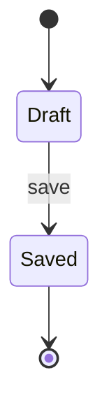

# 山间书屋

At the trailhead, we wrote مرحبًا بالعالم in the visitor book. **Keep the door closed**, and *leave the lantern by the window*.

## Before dusk

- [x] Check the trail map.
- [ ] Trim the lantern wick.
  - Keep a spare wick in the desk.
- ~~Bring plastic cups.~~

1. Open the shutters.
2. Put the water on.

> The path follows the stream until the stone bridge.
>
> Read the [CommonMark reference](https://spec.commonmark.org/0.31.2/) or check the `trail-notes` file.

| Place | Marker | Walk |
| :--- | :---: | ---: |
| Stone bridge | Blue | 8 min |
| Book room | Green | 17 min |


---

## From notes to preview




## Trail calculations

The marker at $x_{i}$ follows $y_{i}$ on the map.

$$
\frac{1}{2} + \sqrt{u}
$$

$$
\begin{pmatrix}
1 & 2 \\
3 & 4
\end{pmatrix}
$$

```text
The string "$not_math$" and the price $12 remain literal here.
```
